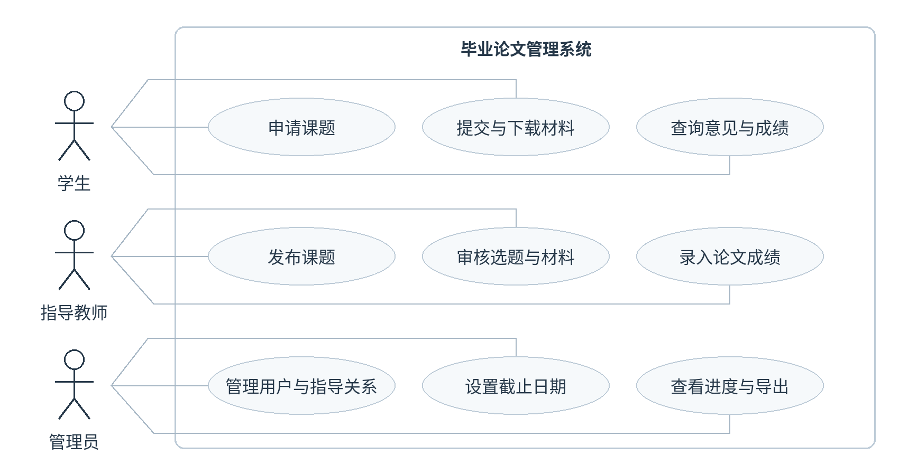
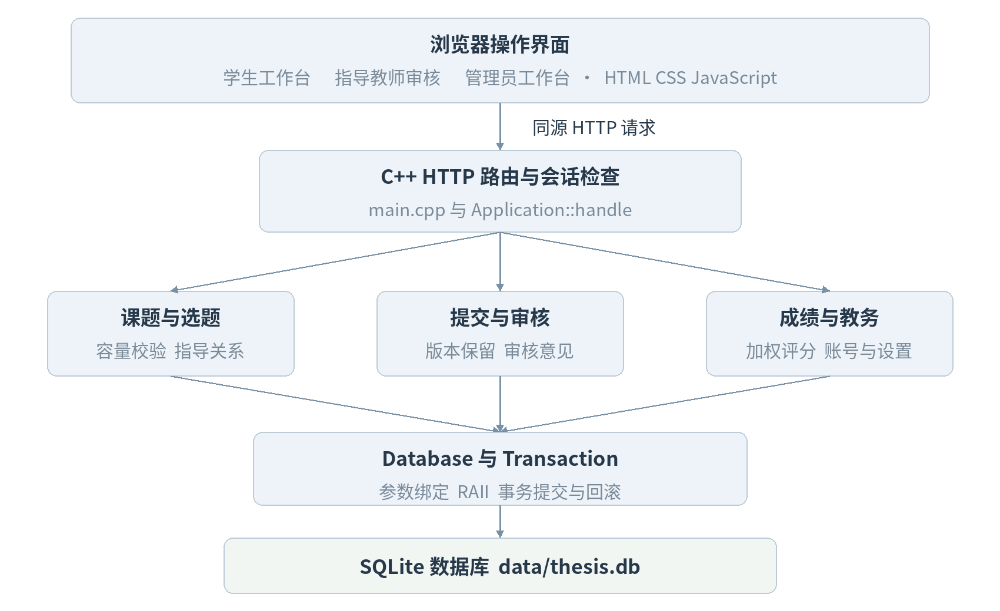
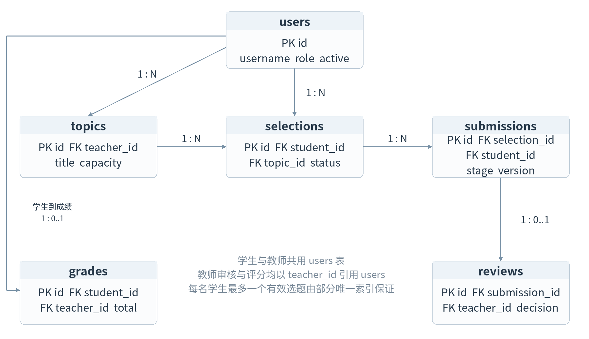
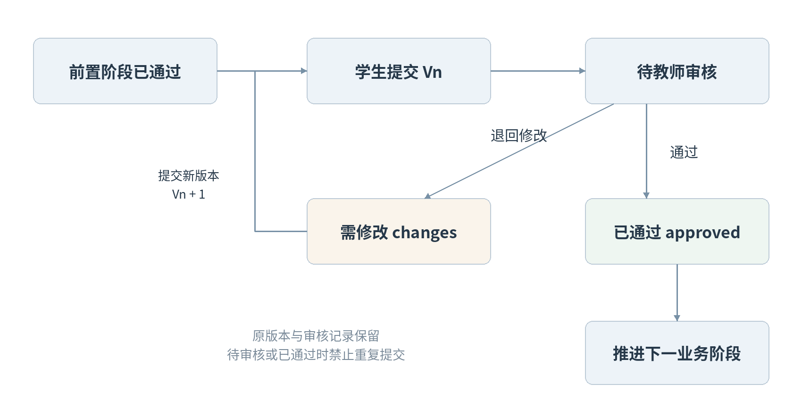

# 毕业论文管理系统 软件工程实践报告

开发语言 C++17    数据库 SQLite    项目版本 1.0.0

报告日期 2026 年 11 月 4 日

### 摘要

本项目面向软件工程课程实践，实现学生、指导教师和管理员协同使用的毕业论文管理系统。系统以 C++17 承担 HTTP 服务、身份认证、业务规则和数据库操作，以浏览器提供中文界面，使用 SQLite 持久保存选题、材料版本、审核意见和成绩。核心流程为课题发布、学生选题、教师确认、开题审核、论文审核和成绩归档。

交付内容包括可编译的 C++ 源码、离线第三方依赖、数据库结构、启动说明、自动化测试及本报告。实际验证已通过 70 项接口测试、31 项 DOM 交互检查和 15 项密码及编码检查。完整浏览器视觉验收和 Windows 运行验证尚未完成。

### 阅读顺序

1 项目概述与可行性

2 需求分析与验收规则

3 用例设计

4 总体结构与模块设计

5 数据库与完整性设计

6 业务实现与接口设计

7 测试设计与实际结果

8 部署演示与项目总结

适用范围为本地课程演示。报告中的功能、状态、字段与测试记录对应同一份交付源码；演示人物和业务数据均为虚构。

## 1 项目概述与可行性

### 1 1 项目目标

毕业论文管理涉及多个角色和多次材料提交。如果选题、文件和教师反馈分散保存，容易产生指导关系不清、版本混淆和进度难以汇总的问题。本项目将这些记录放入同一业务流程，使学生知道下一步任务，教师能定位待办，管理员能汇总进度。

课程实践目标是形成从需求到设计、实现、测试的可追溯成果。系统采用浏览器作为界面，C++ 为唯一业务后端，避免为完成图形界面而引入 Qt 安装要求；使用 SQLite 文件数据库，使演示不依赖单独的数据库服务器。

| 角色 | 主要目标 | 可见范围 |
| --- | --- | --- |
| 学生 | 完成选题和材料提交，查看反馈与成绩 | 本人记录、教师基本信息、课题和公告 |
| 指导教师 | 发布课题，完成指导、审核和成绩录入 | 本人课题下的申请、学生与材料 |
| 管理员 | 维护账号、指导关系、阶段安排与统计 | 全部业务记录和操作日志 |

### 1 2 可行性分析

| 维度 | 判断与依据 |
| --- | --- |
| 技术 | GCC 13.3.0 可实际编译 C++17；随包提供 SQLite、HTTP、JSON 与 SHA256 源码，已验证接口与数据持久化。 |
| 运行 | 普通电脑运行一个 C++ 进程，用浏览器访问本机地址；首次启动自动建库并生成虚构演示数据。 |
| 经济 | 不依赖付费服务。源码使用的公共领域或 MIT 组件均附许可，不将联网服务作为运行前提。 |
| 规模 | 定位小规模课程演示。业务接口由互斥锁串行执行，以简化事务一致性；尚未做负载测试。 |

### 1 3 交付边界

实现账号管理、选题、指导关系、材料版本、审核、成绩、截止日期、公告和 CSV 导出。论文查重、文档内容解析、答辩委员会流程和互联网部署不在本次范围内，答辩分数由指导教师录入。

## 2 需求分析与验收规则

功能需求以 FR 编号标识。验收以服务端状态和数据库记录为依据，界面的按钮可用性只作为操作提示。

| 编号 | 功能 | 验收条件 |
| --- | --- | --- |
| FR01 | 登录与角色权限 | 三类用户使用密码登录；未登录不能读取业务数据。 |
| FR02 | 课题发布与检索 | 教师发布本人课题；管理员可指定教师；学生可按研究方向和关键词检索。 |
| FR03 | 学生选题 | 每名学生最多一项待审或已确认选题；待审申请可撤回。 |
| FR04 | 指导关系确认 | 教师只能审核自己课题的申请；确认时检查剩余名额。 |
| FR05 | 管理员分配 | 可给尚未确认课题的学生分配课题，关闭原待审申请并保留记录。 |
| FR06 | 材料提交与版本 | 选题通过后提交开题，开题通过后提交论文；需修改时新建版本。 |
| FR07 | 材料审核与下载 | 本人、指导教师和管理员可下载；仅指导教师可审核最新待审版本。 |
| FR08 | 成绩管理 | 论文通过后才能评分；总评按 20%、50%、30% 自动计算。 |
| FR09 | 用户管理 | 管理员创建、启停账号；禁止停用自己和仍有未完成任务的用户。 |
| FR10 | 阶段与公告 | 管理员设置有效、有序的截止日期并发布公告；全体用户可读公告。 |
| FR11 | 统计与追溯 | 管理员查看学生进度、导出 CSV、查看最近操作；日志不记录密码。 |
| FR12 | 密码与持久化 | 用户可改密并注销全部会话；业务数据与有效会话在重启后保留。 |

### 2 1 非功能要求

可移植性要求使用 C++17 和跨平台组件；本次验证平台为 Linux。数据完整性依靠事务、外键、唯一索引和业务校验共同保证。可用性要求提供中文界面、清晰错误反馈和空结果提示。可维护性要求将 HTTP、业务、数据访问、密码处理和界面分离。

## 3 用例设计

系统分为学生、指导教师和管理员三个业务参与者。所有角色共用登录、公告阅读和修改密码功能，下图集中展示角色专属任务。



| 用例 | 前置条件 | 主要步骤与结果 |
| --- | --- | --- |
| 申请并确认课题 | 学生已登录，未持有有效选题 | 学生申请；教师检查方向与名额；通过后建立指导关系。拒绝或撤回后可重新申请。 |
| 提交与审核开题 | 选题已确认，未超过开题截止日 | 学生上传；教师下载并通过或退回。退回后提交新版本，旧版本仍可追溯。 |
| 论文审核与评分 | 开题已通过，论文已提交 | 教师通过论文后录入三项成绩；服务端计算总评，学生查看归档结果。 |
| 管理与统计 | 管理员已登录 | 维护账号和日期，按需要分配未确认课题，查看全体学生进度并导出。 |

正常主路径为发布课题、申请、确认、开题通过、论文通过、成绩录入。拒绝选题与退回材料属于可恢复分支，不删除历史记录。

## 4 总体结构与模块设计

采用浏览器、C++ 应用和 SQLite 数据库三层结构。浏览器通过同源 JSON 接口请求操作，后端重新检查用户身份与业务状态，不依赖前端传入的角色、学生身份或总评结果。



| 文件或类型 | 职责 |
| --- | --- |
| main.cpp | 配置 HTTP 服务、绑定路由、提供静态资源、处理启动参数与响应头。 |
| Application | 组织登录、可见数据查询、变更校验、文件授权下载与统计导出。 |
| Database 与 Statement | 拥有 SQLite 连接和语句资源；执行参数绑定并转换查询结果。 |
| Transaction | 进入时开启事务；显式提交；异常离开时自动回滚。 |
| security.hpp 与 web | 前者处理密码派生、随机令牌和编码；后者仅提供界面及表单通信。 |

HTTP 线程池设置为 4 个工作线程、32 个排队任务。Application 用互斥锁串行化业务请求，再通过 BEGIN IMMEDIATE 事务保护写操作。该策略降低了课程项目并发控制的复杂度，吞吐能力未经压测。

## 5 数据库与完整性设计

数据库包含 users、sessions、topics、selections、submissions、reviews、grades、notices、settings、audit_logs 十张表。以下展示核心业务实体；教师相关外键在数据字典中补充。



### 5 1 完整性规则

用户与课题使用自增主键，用户账号唯一。选题历史保留多行，但对 pending 和 approved 状态创建学生编号的部分唯一索引，使每名学生只有一项有效选题。每次教师确认或管理员分配都在事务内重新统计已通过人数，避免突破课题容量。

同一学生、阶段与版本的组合唯一；每份材料最多一条审核记录；每名学生最多一条成绩记录。数据库 CHECK 限制角色、状态、成绩范围和文件大小，外键保证指导关系与材料记录指向有效实体。角色匹配、审核先后和教师归属由业务层检查。

启用 SQLite 外键与 WAL，建库使用 user_version 标记结构版本。所有外部输入采用绑定参数。更新成绩、审核材料、分配关系和写入操作日志处于同一事务中，异常时回滚。

## 5 2 核心数据字典

| 表名 | 关键字段 | 约束与用途 |
| --- | --- | --- |
| users | id  username  name / role  department / password_hash  active / created_at | id 为主键，username 唯一；role 限定三种角色；active 为 0 或 1。仅存密码派生值。 |
| topics | id  teacher_id / title  direction / description  requirements / capacity  created_at | teacher_id 引用 users；capacity 为 1 到 10。发布时校验教师角色与启用状态。 |
| selections | id  student_id  topic_id / status  comment / created_at  reviewed_at | 学生与课题均有外键；四种状态；部分唯一索引限制有效选题；保留被拒绝和撤回历史。 |
| submissions | id  student_id  selection_id / stage  version  filename / file_base64  file_size / summary  status  created_at | stage 为 proposal 或 thesis；学生、阶段、版本组合唯一；文件大小 1 到 5 MB。文件正文不随列表返回。 |

### 5 3 文件与版本策略

材料以 Base64 文本保存在数据库，避免文件系统与数据库之间出现两份记录不同步。其代价是体积约增加三分之一，因此限制单文件 5 MB，HTTP 请求体最大 8 MB。下载接口在检查归属后还原原始字节，并以附件方式返回。

每次重交在同一学生、同一阶段下查询最大版本并加一。只有上一版本为 changes 时可以重交；pending 或 approved 状态禁止重复提交。文件名不允许路径分隔符或换行，仅允许 PDF、DOC、DOCX、TXT 扩展名，不解析文件内容。

### 5 4 字段类型约定

编号和大小使用 INTEGER；分项成绩与总评使用 REAL；日期、状态与正文使用 TEXT。日期字符串使用年 月 日的固定数字格式，保存格式为 YYYY-MM-DD；业务时间戳按 UTC 保存。完整字段定义以 database/schema.sql 为准。

## 5 5 审核与支撑数据字典

| 表名 | 关键字段 | 约束与用途 |
| --- | --- | --- |
| reviews | id  submission_id  teacher_id / decision  comment  created_at | submission_id 唯一并引用 submissions；teacher_id 引用 users；决定为 approved 或 changes。 |
| grades | id  student_id  teacher_id / process_score  thesis_score / defense_score  total / comment  updated_at | student_id 唯一；学生与教师均引用 users；各分数限制在 0 到 100。总评仅由服务端计算。 |
| sessions | token_hash  user_id / expires_at | token_hash 为主键；仅存随机令牌的摘要；过期、改密和停用后失效。 |
| notices | id  title  body / author_id  created_at | author_id 引用 users；仅管理员可发布，全体登录用户可读。 |
| settings | key  value | key 为主键；维护学年与三个阶段的提交截止日期。 |
| audit_logs | id  user_id  action / detail  created_at | user_id 引用 users；保存关键操作结果，不保存密码、原始令牌或文件正文。 |

### 5 6 记录保留策略

选题拒绝或撤回时仅改变状态，材料重交时新增版本，教师意见作为独立审核记录保存。成绩允许本人指导教师修改并记录操作日志。用户停用采用状态标记，不删除已经引用的历史记录。

教务分配只针对尚未确认课题的学生：先检查目标课题容量，再关闭原待审选题，最后插入已确认记录并写入日志。三个步骤在一个事务中完成，避免留下重复有效关系。

## 6 业务实现设计

### 6 1 选题确认

Application 首先核对登录角色和目标课题归属，再确认申请仍为 pending。通过时重新统计该课题的 approved 数量，只有小于 capacity 才更新。选题更新和日志在同一事务内完成。学生的并发申请另由部分唯一索引兜底。

```text
lock business mutex
begin immediate transaction
check teacher ownership and pending status
check approved_count < capacity
update selection status and review time
insert audit log
commit transaction
```

### 6 2 材料状态推进

开题提交要求已确认选题；论文提交进一步要求最新开题已通过。审核只能由指导教师针对最新待审版本执行。成绩归档后禁止继续提交材料，避免归档分数与后续材料不一致。



## 6 3 接口与权限实现

主要接口如下，完整请求字段、可见性和示例见 docs/API.md。成功响应包含 message，业务冲突、身份问题和字段错误返回相应 HTTP 状态及中文 error。

| 方法 | 路径 | 角色 | 用途 |
| --- | --- | --- | --- |
| POST | /api/login | 全部 | 校验密码，生成 8 小时会话 |
| GET | /api/state | 已登录 | 返回角色可见的记录与设置 |
| POST | /api/topics | 教师或管理员 | 发布课题并校验教师 |
| POST | /api/select | 学生 | 申请课题，检查有效申请和截止日 |
| POST | /api/selections/review | 指导教师 | 确认或拒绝选题 |
| POST | /api/assign | 管理员 | 分配未确认的课题及指导关系 |
| POST | /api/submissions | 学生 | 上传材料，创建新版本 |
| GET | /api/files/{id} | 授权用户 | 检查归属，下载原始文件 |
| POST | /api/reviews | 指导教师 | 通过或退回材料 |
| POST | /api/grades | 指导教师 | 录入分项成绩，自动计算总评 |
| POST | /api/users | 管理员 | 创建账号并派生初始密码 |
| POST | /api/settings | 管理员 | 设置日期与学年 |
| POST | /api/password | 已登录 | 修改密码并注销全部会话 |
| GET | /api/export | 管理员 | 导出含中文 BOM 的统计 CSV |

### 6 4 密码与会话

密码使用 PBKDF2 HMAC SHA256，随机盐 16 字节、迭代 120000 次。会话令牌为 32 字节系统随机数，仅将其 SHA256 摘要保存到数据库，Cookie 设置 HttpOnly 和 SameSite=Strict。POST 要求自定义请求头并校验可用的 Origin；不开放跨域接口。算法依据 RFC 8018，具体实现另做已知向量测试。

记录级权限在下载、审核和评分接口中重新核对。学生只能读取自己的业务数据，教师只能操作自己课题下的记录。前端的隐藏或禁用按钮不替代这些检查。默认本机 HTTP 运行，未配置公网 TLS。

## 7 测试设计与实际结果

### 7 1 环境与方法

实际环境为 Linux x86_64、GCC 13.3.0、C++17、SQLite 3.46.1。使用 Python 标准库向真实 C++ 服务发送黑盒请求，测试独立临时数据库，涵盖正常流程、异常状态、越权、边界和持久化。测试数据不写入演示数据目录。

界面交互采用 Node.js 与 JSDOM 26.1.0，访问同一个真实 C++ 后端，验证登录、导航、表单、审核和成绩显示。JSDOM 不提供浏览器布局，因此此结果不等同于浏览器视觉验收。密码和编码使用单独 C++ 测试程序验证。

| 检查层次 | 执行数量 | 通过 | 未通过 |
| --- | --- | --- | --- |
| 真实服务接口 | 70 | 70 | 0 |
| DOM 交互 | 31 | 31 | 0 |
| 密码与编码向量 | 15 | 15 | 0 |

### 7 2 接口用例分布

| 覆盖类别 | 数量 | 验证重点 |
| --- | --- | --- |
| 基础接口 | 1 | 服务启动与健康响应 |
| 身份与权限 | 27 | 角色与记录归属、会话失效 |
| 边界校验 | 14 | 日期、容量、状态、成绩和重复操作 |
| 业务流程 | 20 | 从选题到归档的前置条件和结果 |
| 文件处理 | 6 | 编码、扩展名、大小、下载字节 |
| 并发与持久化 | 2 | 并发重复申请和重启后保留 |

### 7 3 证据与局限

70 项接口结果保存为 docs/test-results.json，31 项 DOM 结果保存为 docs/ui-test-results.json。检查全部通过；未执行浏览器视觉检查、Windows 实机测试、压力测试和渗透测试，因此不据此宣称生产环境可靠性或大规模并发能力。

## 7 4 代表性测试与需求追踪

| 用例 | 需求 | 检查内容 | 结果 |
| --- | --- | --- | --- |
| IT11 | FR01 | 学生数据隔离且无密码摘要或文件内容泄露 | 通过 |
| IT18 | FR03 | 重复选题被拒绝 | 通过 |
| IT19 | FR04 | 非指导教师不能审核选题 | 通过 |
| IT22 | FR06 | 开题通过前不能提交论文 | 通过 |
| IT26 | FR06 | 超过 5 MB 的文件被拒绝 | 通过 |
| IT32 | FR07 | 其他学生不能下载该文件 | 通过 |
| IT36 | FR06 | 修改重交自动生成第二版本 | 通过 |
| IT45 | FR08 | 成绩权重正确并忽略客户端伪造总评 | 通过 |
| IT48 | FR05 | 管理员分配课题并关闭原待审申请 | 通过 |
| IT61 | FR10 | 选题截止后不能再申请 | 通过 |
| IT65 | FR12 | 更改密码会注销全部会话 | 通过 |
| IT69 | FR12 | 重启后会话与成绩数据仍然保留 | 通过 |

### 7 5 场景验收结果

正常路径验证学生申请、教师确认、开题提交、退回修改、版本重交、开题通过、论文通过和成绩可见。过程成绩 90、论文 88、答辩 92 的总评为 89.6；即使客户端伪造 total 字段，也不影响服务端结果。

异常路径验证其他教师和其他学生无法下载或审核目标材料，超过 5 MB 的文件被拒绝，无效日期和超范围分数被拒绝，待审或已通过材料不能重复提交。两项并发选题请求只能有一项成功；重启后学生成绩与会话仍有效。

DOM 检查进一步验证通过界面申请和撤回、教师发布课题和审核、实时成绩预览、管理员创建及停用用户，以及公告中的 HTML 内容按文本显示。实际布局、移动端显示、文件选择与浏览器下载体验留待本机验收。

## 8 部署与答辩演示

### 8 1 编译与启动

解压后从项目根目录执行。Linux 需要 GCC/G++ 9 或更新版本和 Bash，Windows 可使用 MinGW-w64；Windows 尚未实机验证。第三方源码已附，正常运行不依赖联网或其他后端。

```text
Linux    bash scripts/build.sh
         bash scripts/run.sh
Windows  scripts\build.bat
         scripts\run.bat
Browser  http://127.0.0.1:8080
```

| 账号 | 身份 | 统一初始密码 |
| --- | --- | --- |
| student01 | 学生 | Demo@2026 |
| teacher01 | 指导教师 | Demo@2026 |
| admin | 管理员 | Demo@2026 |

### 8 2 建议演示顺序

| 步骤 | 操作 | 预期现象 |
| --- | --- | --- |
| 1 | 学生申请 C++ 毕业论文管理课题 | 出现待确认记录 |
| 2 | 教师同意选题 | 指导关系确认，开题入口可用 |
| 3 | 学生提交开题，教师退回修改 | 保留 V1 与审核意见 |
| 4 | 学生重交，教师通过开题 | 生成 V2，论文入口可用 |
| 5 | 学生提交论文，教师审核通过 | 可录入成绩 |
| 6 | 教师录入 90 88 92 | 总评自动为 89.6 |
| 7 | 学生查看成绩，管理员导出 | 归档状态与 CSV 内容一致 |

数据库和材料保存在 data 目录。备份或恢复前先停止服务，并复制整个目录；完整维护步骤见 README.md。

## 8 3 项目总结与后续改进

本次实践完成一个以 C++17 为业务后端的毕业论文管理系统，覆盖三类角色和从选题到成绩归档的闭环。通过需求编号、用例、模块结构、数据库约束、接口和测试记录，可追溯同一业务规则在设计和实现中的位置。

实现中的关键取舍是采用浏览器界面降低桌面框架依赖，用 SQLite 简化本地运行，用不可覆盖的材料版本保存指导过程，并用事务与唯一索引保证选题一致性。接口、DOM 和算法检查均已实际执行，完整浏览器与 Windows 的验收仍需在目标电脑完成。

### 8 4 已知边界

本项目没有实现查重、文档内容解析、答辩委员会流程和公网部署。上传文件只检查扩展名、编码与大小，并不进行内容安全扫描。指导关系确认后不提供改派，成绩归档后不提供材料解锁。业务互斥锁和完整状态聚合查询适合小规模演示，后续可改为细分服务、分页接口和更精细的并发控制。

后续改进应先完成目标操作系统与浏览器验收，再根据学校规则增加答辩角色、成绩审批和归档导出；若转为互联网服务，还需单独设计 TLS、部署密钥、运维备份和容量测试。这些属于后续范围，不计入本次已实现功能。

### 参考资料与交付文件

1 SQLite C 接口文档  https://www.sqlite.org/c3ref/intro.html

2 SQLite 部分索引说明  https://www.sqlite.org/partialindex.html

3 cpp httplib 源码与许可  https://github.com/yhirose/cpp-httplib/tree/v0.18.3

4 nlohmann json 源码  https://github.com/nlohmann/json/tree/v3.11.3

5 PicoSHA2 源码  https://github.com/okdshin/PicoSHA2

6 RFC 8018 密码派生规范  https://www.rfc-editor.org/rfc/rfc8018.html

源码与运行步骤见 README.md；数据库见 database/schema.sql；接口见 docs/API.md；完整测试结果见 docs 中的 JSON 文件。第三方组件版本与下载摘要见 third_party/SOURCES.json。
